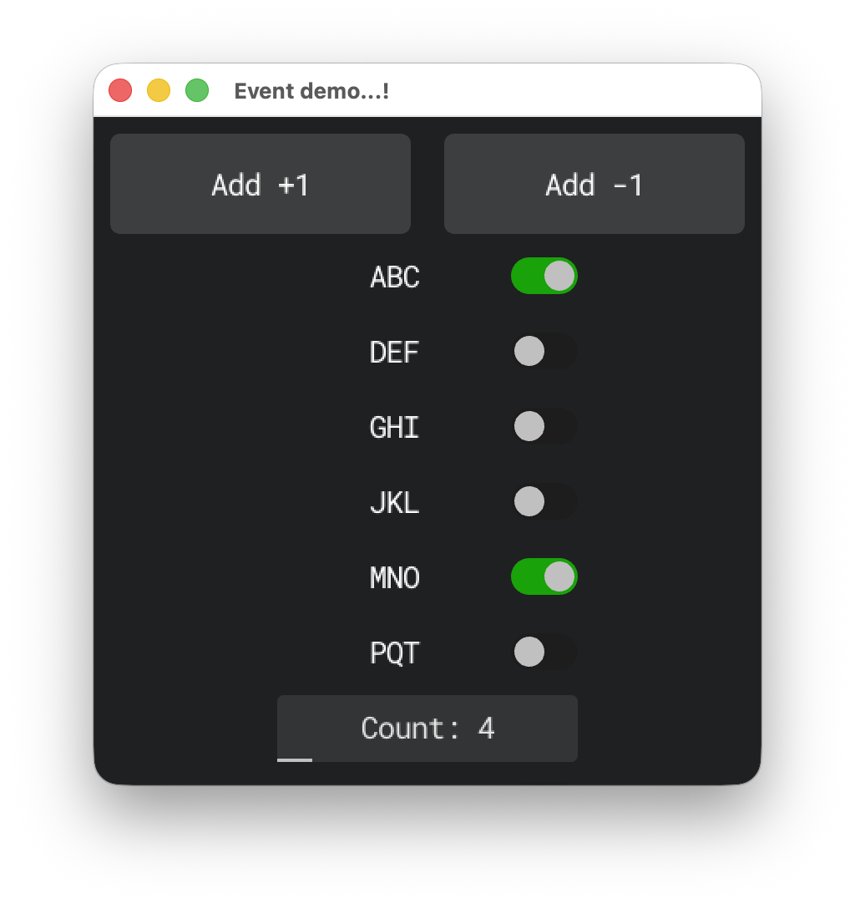
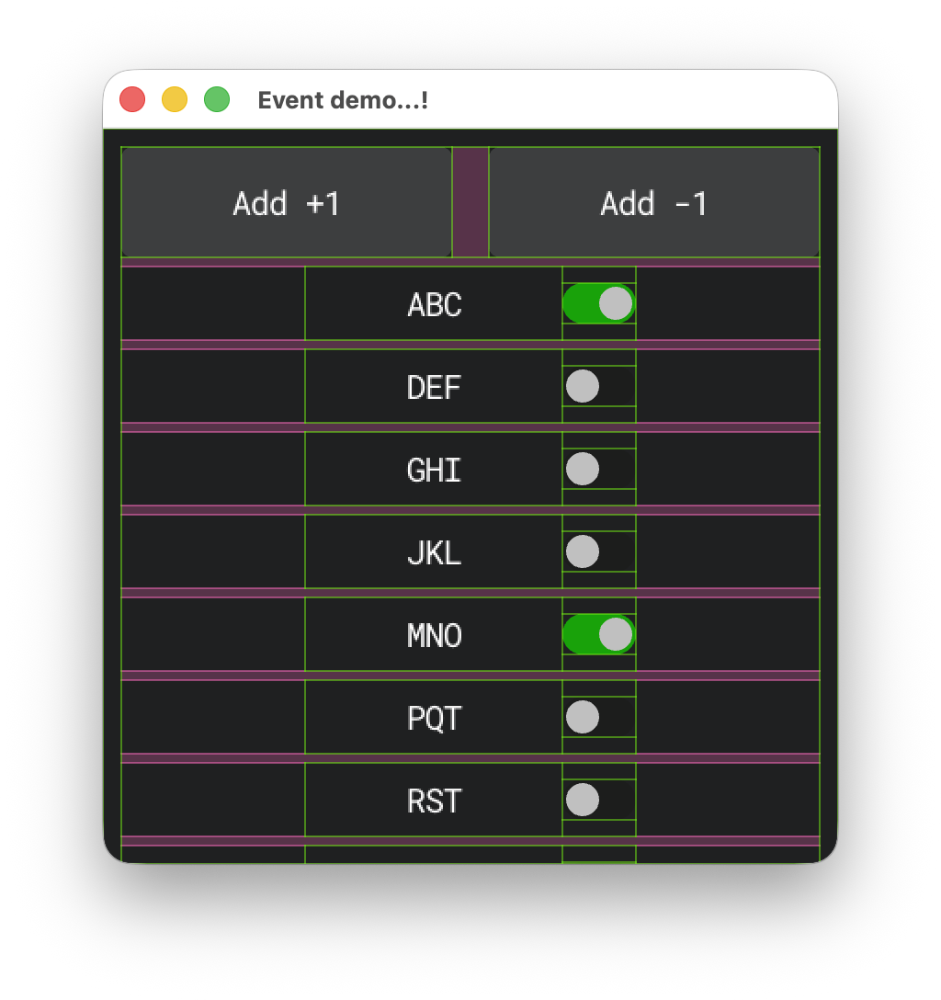

EG-GUI
====

A modular and composable GUI library written in modern C++.  
It uses [raylib](https://www.raylib.com/) for drawing and input handling.

It uses a glue layer to interface with the raylib API so that the underlying
libary can be swapped in easily with minimal code changes.

Features
=======

 - Debug view for debugging widget position and sizes
 - Intuitive event handling via chaining
 - Generic animation framework
 - Overlays and Toasts
 - Containers and layout algorithms
   - Padded box
   - GTK like Grid container
   - Flexbox style horizontal/vertical stacking containers
   - Scroll area with scrollbars
 - Interactive widgets
   - Button
   - Slider
   - Scrollbar
   - Text input

Screenshots
===========

🚧🚧 <=======> 🚧🚧
